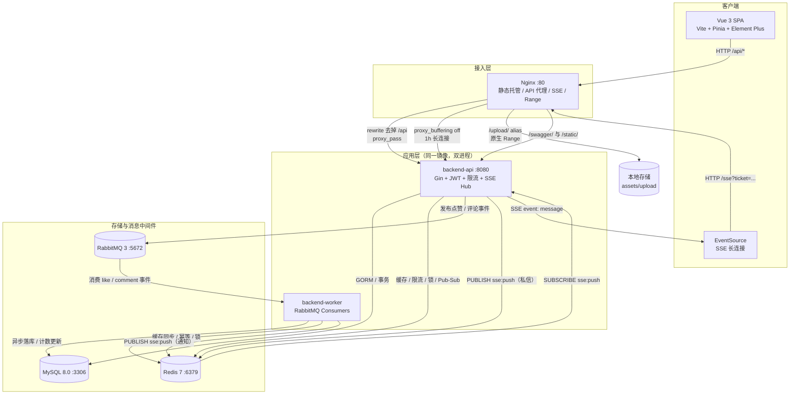
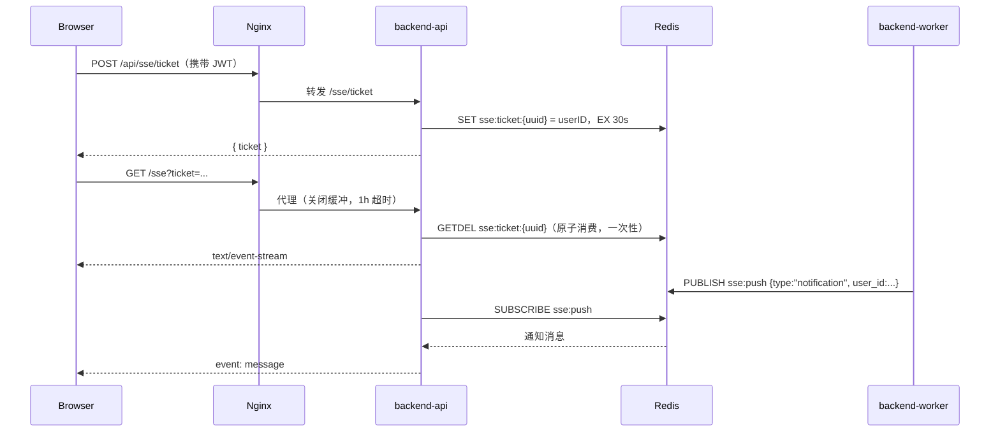

# 高并发仿抖音短视频 Feed 流系统

<p align="center">
  <strong>Go + Gin + GORM · MySQL · Redis · RabbitMQ · SSE · Vue 3 · Docker</strong><br/>
  API / Worker 双进程架构 · 全栈容器化 · 46 个 API 路径 / 47 个操作 · 129 个 Go 测试用例
</p>

<p align="center">
  
  
  
  
  
  
</p>

> 一句话概括：用一套可一键部署的全栈工程，完整实现短视频场景下的 Feed 流、点赞、评论、关注、通知与私信，并把“跨进程实时推送、异步最终一致性、缓存一致性、游标分页、幂等与降级”这些高并发后端的关键问题落到代码里。

---

## 目录

- [1. 项目简介](#1-项目简介)
- [2. 技术栈](#2-技术栈)
- [3. 系统架构](#3-系统架构)
- [4. 核心亮点](#4-核心亮点)
- [5. 核心功能模块](#5-核心功能模块)
- [6. 数据模型与索引设计](#6-数据模型与索引设计)
- [7. 快速启动](#7-快速启动)
- [8. API 文档](#8-api-文档)
- [9. 项目结构](#9-项目结构)
- [10. 工程化与测试](#10-工程化与测试)
- [11. 设计权衡与后续演进](#11-设计权衡与后续演进)
- [12. 生产部署清单](#12-生产部署清单)

---

## 1. 项目简介

这是一个面向高并发场景设计的**仿抖音短视频 Feed 流系统**，覆盖短视频产品的完整闭环：

- **用户域**：注册、登录、JWT 刷新、登出、资料修改、头像上传、改密。
- **视频域**：普通上传、分片断点续传、封面生成与上传、视频发布、标签管理、视频详情。
- **Feed 域**：最新流、关注流、热度流、点赞榜、标签流，统一复合游标分页。
- **互动域**：点赞 / 取消点赞、评论 / 回复 / 级联删除、关注 / 取关。
- **通知域**：点赞、评论、关注三类通知，支持未读数、单条已读、全部已读、取消历史保留。
- **私信域**：发送私信、会话列表、历史消息、SSE 实时到达提醒。
- **实时链路**：Redis Pub/Sub + SSE，将 API 进程与 Worker 进程的事件统一推送到浏览器。

系统采用 **API + Worker 双进程架构**：API 进程承载 Gin HTTP 服务与 SSE 长连接；Worker 进程独立消费 RabbitMQ 中的点赞、评论事件，完成异步落库、缓存同步与通知状态机处理。两个进程由**同一份 Docker 镜像**构建，通过不同启动命令运行，既解耦了慢任务，又降低了部署复杂度。

### 工程数据

| 维度 | 数据 |
| --- | --- |
| 后端 API 路径 / 操作 | 46 条路径 / 47 个操作（Swagger 自动生成） |
| Go 测试 | 15 个测试文件，129 个 `Test` 函数，`go test ./...` 全部通过 |
| Docker Compose 服务 | 6 个：MySQL、Redis、RabbitMQ、backend-api、backend-worker、Nginx |
| 数据表 | 用户、视频、视频标签、点赞、评论、关注、通知、私信 |
| 实时通道 | 单条 SSE 长连接同时承载通知与私信，按 `type` 分流 |

### 设计原则

1. **数据库是事实来源**：Redis、MQ、本地缓存都只是加速或解耦手段，任何组件故障都能回源 MySQL。
2. **读写路径分离**：点赞、评论等写操作经 MQ 异步消费；Feed、详情、会话列表等读路径做批量查询与缓存。
3. **正确性优先于性能优化**：通知去重最终由数据库唯一索引兜底，缓存锁只用于降低竞争。
4. **故障可降级**：Redis 不可用时禁用缓存、RabbitMQ 不可用时同步写库、限流组件异常时放行，避免中间件故障拖垮整个服务。

---

## 2. 技术栈

### 2.1 后端

| 技术 | 版本 | 作用 |
| --- | --- | --- |
| Go | 1.26.3 | 后端主语言，API / Worker 双进程 |
| Gin | v1.12.0 | HTTP 框架、路由分组、中间件 |
| GORM | v1.31.2 | ORM、自动迁移、事务、复合索引声明 |
| golang-jwt/jwt | v5.3.1 | JWT 签发与校验，仅允许 HS256 |
| go-redis | v9.22.0 | 缓存、分布式锁、ZSet、Pub/Sub、Lua 脚本 |
| amqp091-go | v1.14.0 | RabbitMQ 生产者与消费者 |
| Zap | v1.28.0 | 结构化日志，dev 文本 / prod JSON |
| Swaggo | v1.16.4 | Swagger 注解解析与文档生成 |
| gin-swagger | v1.6.1 | Swagger UI 路由 |
| bcrypt | x/crypto v0.58.0 | 密码哈希 |
| miniredis | v2.37.0 | 单元测试中的 Redis 替身 |
| SQLite driver | v1.6.0 | 单元测试中的轻量数据库 |

### 2.2 前端

| 技术 | 版本 | 作用 |
| --- | --- | --- |
| Vue | 3.5.45 | 组合式 API，单页应用 |
| Vite | 8.3.7 | 开发服务器与生产构建 |
| Pinia | 4.1.0 | 全局状态管理（SSE / 通知 / 私信） |
| Vue Router | 5.4.0 | 路由与登录守卫 |
| Element Plus | 2.14.8 | UI 组件库，支持暗色主题 |
| Axios | 1.21.0 | 统一请求封装、JWT 注入、401 处理 |
| EventSource | 浏览器原生 | SSE 长连接客户端 |

### 2.3 中间件与基础设施

| 技术 | 版本 / 镜像 | 作用 |
| --- | --- | --- |
| MySQL | 8.0 | 业务主存储，utf8mb4，Asia/Shanghai |
| Redis | 7-alpine | 缓存、计数、限流、分布式锁、Pub/Sub、ZSet 会话列表 |
| RabbitMQ | 3-management | 点赞 / 评论事件异步解耦，DLX 死信队列 |
| Nginx | alpine | 前端静态托管、API 反向代理、SSE 长连接、上传资源 Range |
| Docker / Compose | Compose v2 | 全栈容器化与健康检查编排 |

---

## 3. 系统架构

### 3.1 总体架构图



### 3.2 流量走向

1. **浏览器访问前端**：Nginx 托管 `frontend/dist`，`try_files` 回退到 `index.html`，支持 Vue Router history 模式。
2. **业务 API**：前端统一请求 `/api/*`，Nginx 通过 `rewrite ^/api(/.*)$ $1 break` 去掉前缀后转发到 `backend-api:8080`。
3. **SSE 实时通道**：前端 `EventSource` 连接同源 `/sse?ticket=...`，Nginx 使用独立 `location = /sse`，关闭 `proxy_buffering`，读写超时提升到 1 小时，确保消息不被缓冲。
4. **上传资源**：`/upload/` 由 Nginx 直接 `alias` 到宿主机挂载目录，视频天然支持 HTTP Range，边下边播，不占用 Go 进程文件流。
5. **Swagger 与内置静态资源**：`/swagger/`、`/static/` 转发给 Go API；用户上传资源不经过 Go。
6. **异步事件**：API 将点赞 / 评论事件投递到 RabbitMQ；Worker 消费后写 MySQL、同步 Redis，并将通知发布到 Redis `sse:push` 频道。
7. **SSE 扇出**：每个 API 实例都订阅 `sse:push`，收到消息后通过本机 Hub 推送给该用户的所有在线连接，因此 Worker 与 API 可以是完全独立的多实例进程。

### 3.3 进程职责

| 进程 | 启动命令 | 核心职责 |
| --- | --- | --- |
| `backend-api` | `./api` | HTTP 路由、JWT 鉴权、限流、Feed 查询、私信读写、SSE Hub、点赞 / 评论事件投递 |
| `backend-worker` | `./worker` | 消费 `like.events` / `comment.events`、异步落库、点赞计数与热度同步、通知状态机、SSE 通知发布 |

**为什么拆成两个进程？**

- 点赞、评论落库、缓存同步、通知处理属于可异步的慢路径，放在 Worker 中不会阻塞 HTTP 请求。
- API 与 Worker 可独立扩缩容：读流量大时扩 API，事件积压时扩 Worker。
- 两者共享同一镜像，CI 只需构建一次；Compose 中通过 `command` 区分启动入口。
- 两者都实现了信号监听与优雅退出：API 等待在途请求（10s），Worker 等待在途消息（5s）。

---

## 4. 核心亮点

### 4.1 基于 Redis Pub/Sub + SSE 的跨进程实时推送

系统只有一条浏览器 SSE 长连接，但同时承载 **互动通知** 与 **私信消息**，前端按消息中的 `type` 字段分流：`notification` 进入通知中心，`message` 进入私信。

**跨进程链路**



**设计要点**

- **一次性 Ticket 鉴权**：浏览器原生 `EventSource` 无法自定义 `Authorization` 头。登录用户先通过 `POST /sse/ticket` 换取 30 秒有效的一次性 ticket，`GET /sse` 用 Redis `GETDEL` 原子消费，避免 ticket 被重放。
- **Hub 本地扇出**：`Hub` 使用两级 `sync.Map` 保存 `userID -> clientID -> chan string`，同一用户多端登录时可以向所有连接广播。
- **慢客户端保护**：每个连接使用带 10 个缓冲位的 channel，发送采用非阻塞 `select`；通道满时丢弃该条 SSE 消息。通知已经落库，前端重连或刷新列表仍能补齐，不会因为某个卡顿客户端阻塞全局推送。
- **连接保活**：服务端每 15 秒发送 `heartbeat: ping`；关闭 SSE 请求的写超时（`SetWriteDeadline(time.Time{})`），避免长连接被 `http.Server` 的 `WriteTimeout` 截断。
- **代理层配合**：Nginx 关闭 `proxy_buffering`，Go 响应头再设置 `X-Accel-Buffering: no`，否则消息会被 Nginx 攒批，实时性失效。
- **前端连接管理**：`store/sse.js` 是全局唯一连接管理器，负责获取 ticket、建立连接、3 秒后自动重连、事件订阅与分发；组件只订阅自己关心的 `type`，连接生命周期与业务状态解耦。
- **降级兜底**：Redis 不可用时 SSE 订阅器循环重试；消息丢失不影响数据库中的通知与私信记录。

### 4.2 基于 Redis ZSet + Lua 的会话列表与并发时序控制

私信会话列表是典型的“按最后消息时间排序 + 展示最后一条消息 + 未读数”场景。系统没有每次 `GROUP BY` 扫消息表，而是用 Redis 组合结构维护：

| Key | 结构 | 含义 |
| --- | --- | --- |
| `im:sessions:{userID}` | ZSet | member = 对方 userID，score = 最后一条消息的 Unix 时间戳 |
| `im:session_detail:{userID}:{peerID}` | Hash | `last_content`、`last_time`、`last_message_id`、`unread_count` |

**并发时序控制**

消息发送后，按接收者与发送者两个视角分别更新会话。接收者侧通过 Lua 脚本原子完成：

1. 读取当前 `last_time` 与 `last_message_id`；
2. 仅当新消息的 `(时间, 消息ID)` 更大时才更新 Hash；
3. 同时 `HINCRBY unread_count 1`；
4. 刷新 TTL。

发送者侧使用另一段 Lua 脚本，只更新最后消息、不增加未读数。这样即使两条消息并发到达、Redis 命令交错执行，也不会出现“旧消息覆盖新消息”或“未读数重复累加”。

**其他细节**

- ZSet 写入使用 `ZADD GT`，只有新 score 更大时才更新，避免网络乱序导致会话顺序回退。
- `ListSessions` 先用 `ZRANGE REV` 取对方 ID，再用 Pipeline 批量 `HGETALL` 会话详情；部分 Hash 过期时，只对缺失会话执行一次 `WHERE session_id IN (...)` 的批量查询并回写，避免 N+1。
- Redis 会话整体丢失时，回源 MySQL：用 `UNION ALL + GROUP BY target_id + MAX(id)` 一次查出用户最近的会话，再异步预热 ZSet 与 Hash。
- 历史消息按 `id` 游标分页：`last_id` 传上一页最老一条消息 ID，SQL 用 `id < ? ORDER BY id DESC LIMIT ?`；服务层多取一条（`limit + 1`）判断 `has_more`，不执行额外的 `COUNT(*)`。
- 会话与详情 TTL 为 30 天，数据库始终保留完整私信历史，缓存过期不会丢数据。

### 4.3 基于状态机的通知防重与历史保留

通知表没有采用“重复就删 / 覆盖”的简单策略，而是实现了 `active → cancelled` 状态机：

```text
       互动发生                 取消互动
(none) ────────> active ────────────────> cancelled
                   ▲                          │
                   └────── 再次互动 ──────────┘
                         （插入新的 active 记录）
```

**核心设计：`active_key` 唯一索引**

- 业务键为 `(actor_id, receiver_id, type, target_id)`，普通索引 `idx_notification_tuple` 支持按业务键查最新记录。
- `active_key` 字段只在 `status = active` 时写入 `"actor:receiver:type:target"`；取消时置为 `NULL`。
- MySQL 唯一索引允许多个 `NULL`，因此：
  - 同一业务键**最多只能有一条 active 通知**；
  - `cancelled` 历史记录可以无限保留，通知中心能看到完整的点赞 / 取关历史；
  - 即使 Redis 分布式锁失效、MQ 重复投递或并发插入，数据库唯一索引仍能兜底。
- `FindLatestByTuple` 按 `id DESC` 取最新一条：若仍是 `active`，说明重复通知，直接跳过；若为 `nil` 或 `cancelled`，则插入一条全新的 active 记录。
- `AutoMigrate` 不会回填历史数据，也不会删除模型中已移除的旧索引。启动时 `MigrateNotificationState` 做两步幂等迁移：为历史 active 记录回填 `active_key`；删除旧的 `uk_ignore` 唯一索引，避免“取消后再次点赞 / 关注”触发唯一键冲突。API 与 Worker 并发启动时也安全。

**防重与乱序处理**

1. 按业务键获取 Redis 分布式锁（`SET NX` + Lua 比对 token 释放），TTL 5 秒，最多尝试 3 次。
2. 锁内先复核互动是否仍然有效：点赞查 `likes` 表，关注查 `socials` 表。这样可以处理“点赞 → 取消”两条异步消息乱序到达，避免给已经取消的互动补发通知。
3. 查最新记录，已经 active 则直接返回，不增加未读数、不推 SSE。
4. 插入新记录；若触发 `uk_active` 唯一键冲突，按幂等成功处理。
5. 锁外再发布 SSE，避免网络耗时拉长锁占用时间。
6. 取消通知只把最新 active 记录置为 `cancelled`、清空 `active_key`、标记已读，不推送 SSE；重复取消按幂等处理。

**未读数一致性**

- 新增通知成功后 `INCR unread:{userID}`，TTL 7 天。
- 如果 `INCR` 返回 1，说明缓存 key 之前不存在（过期或 Redis 重启），立即查一次 MySQL 真实未读数并 `SETNX` 回填，避免红点从 1 开始漂移。
- 标记已读 / 全部已读 / 取消通知时直接删除未读缓存，下次读取回源数据库重算，避免 `DECR` 在并发和负数边界上的复杂处理。
- 通知列表使用 `(created_at, id)` 复合游标：`last_time` 与 `last_id` 必须成对传入，查询条件为 `created_at < ? OR (created_at = ? AND id < ?)`，返回 `next_last_time` / `next_last_id`，避免同一秒内多条通知在翻页时重复或遗漏。

### 4.4 深度优化的 Feed 流游标分页与 N+1 查询消除

#### 游标分页

Feed 的 5 条读路径都使用 **Keyset Pagination（游标分页）**，不使用 `OFFSET`：

| 接口 | 排序键 | 游标条件 |
| --- | --- | --- |
| `/feed/list` | `created_at DESC, id DESC` | `(created_at, id) < (?, ?)` |
| `/feed/listByFollowing` | `videos.created_at DESC, videos.id DESC` | `(videos.created_at, videos.id) < (?, ?)` |
| `/feed/listByPopularity` | `popularity DESC, id DESC` | `(popularity, id) < (?, ?)` |
| `/feed/listByLikesCount` | `likes_count DESC, id DESC` | `(likes_count, id) < (?, ?)` |
| `/feed/listByTag` | `videos.created_at DESC, videos.id DESC` | `(videos.created_at, videos.id) < (?, ?)` |

关键点：

- 使用 MySQL 行值比较 `(a, b) < (?, ?)`，而不是 `a < ? OR (a = ? AND b < ?)`，SQL 更简洁且更容易命中复合索引。
- 主键 `id` 作为并列时的决胜键，保证分页顺序稳定，不会因为同一时间戳或同一热度出现重复 / 漏数据。
- `last_vid` 与 `last_created_at` 必须同时存在，半个游标直接报错，避免前端拼错参数导致翻页错乱。
- 时间游标使用 Go `time.Time` 绑定为 `DATETIME`，禁止转 Unix 秒后与 `DATETIME` 比较，避免隐式类型转换导致索引失效。
- 点赞榜游标使用数据库排序键 `videos.likes_count`，而不是 Redis 中的展示计数；缓存与数据库不一致时也不会跳数据。

#### 消除 N+1

一页视频最多 20 条，若逐条查询作者、点赞状态、关注状态、点赞数、评论数、标签，会产生 6 类 N+1 查询。`assembleFeedItems` 在组装 VO 前统一做批量查询：

- 作者昵称与头像：`BatchGetProfiles(authorIDs)`，一次 SQL。
- 当前用户点赞状态：`BatchGetIsLike(userID, videoIDs)`。
- 当前用户关注状态：`BatchIsFollow(userID, authorIDs)`。
- 点赞总数：`BatchGetLikeCount(videoIDs)`，优先 Redis 计数。
- 评论总数：`BatchGetCommentCount(videoIDs)`，优先 Redis 计数。
- 视频标签：`ListTagsByVideoIDs(videoIDs)`，一次 `IN` 查询。

此外：

- 游客（`loginUserID = 0`）直接短路，不查询点赞 / 关注状态。
- 关注流直接 `JOIN socials` 按 `follower_id` 过滤，避免把全量关注 ID 拉进内存再拼 `IN` 子句。
- 标签流通过 `video_tag` 关联表的 `(tag, video_id)` 索引查询，替代 `FIND_IN_SET` 全表扫描。
- 作者信息、点赞 / 关注状态、评论数、标签都属于附属数据，任一查询失败只降级为空值或 0，不阻断 Feed 主流程。

#### 复合索引

`videos` 表围绕分页路径建立了多组复合索引：

- `idx_videos_author_created_id(author_id, created_at, id)`
- `idx_videos_created_id(created_at, id)`
- `idx_videos_popularity_id(popularity, id)`
- `idx_videos_likes_count_id(likes_count, id)`
- `idx_videos_popularity_time_id(popularity, create_time, id)`

索引列顺序与 `ORDER BY` 的排序键严格对齐，避免深翻页时回表排序产生 `filesort`。

### 4.5 RabbitMQ 可靠消费：重试、死信与幂等

点赞与评论写路径通过 RabbitMQ 解耦：

- `like.events`：`like.like` / `like.unlike` 路由键。
- `comment.events`：`comment.create` / `comment.delete` 路由键。
- 交换机与队列均持久化，消息 `DeliveryMode = Persistent`。
- 每个业务队列绑定死信交换机 `dlx.events`，死信队列名为 `<queue>.dlx`。

**可靠消费策略**

| 问题 | 方案 |
| --- | --- |
| 临时故障（数据库抖动、Redis 超时） | 指数退避后重新投递，最多 3 次；退避 200ms / 400ms / 800ms，封顶 2s |
| 达到重试上限 | `Nack(false, false)` 转入死信队列，保留现场供人工排查 |
| 重试计数丢失 | 不使用 `Nack(requeue=true)`，而是 republish 并在消息头累加 `x-retry-count`；`requeue` 无法携带计数，会导致故障期间无限热循环 |
| MQ 重复投递 | Redis 记录 `event_id`，TTL 24 小时；已处理事件直接 ACK |
| 数据库唯一键冲突 | 视为幂等成功，ACK 消息并补偿缓存同步，避免无意义重试 |
| 消息体畸形 / 未知动作 | 直接 ACK 或转入死信，避免毒消息阻塞队列 |
| 消费协程 panic | 评论消费者外层 `recover`，捕获后 Nack 到死信，防止 Worker 进程被带崩 |
| 单条消息处理过久 | 每条消息独立 2 秒超时；使用 `context.WithoutCancel` 保证优雅关闭时不中断在途处理 |
| 关闭时消息丢失 | `ch.Cancel` 停止投递，`WaitGroup` 等待在途消费，最多 5 秒 |

**降级路径**

- RabbitMQ 连接失败时 API 仍可启动；`LikeMQ` / `CommentMQ` 回退为“已禁用但合法”的实例，投递入口直接短路。
- 点赞 / 评论 Service 检测到 MQ 不可用后，直接同步写数据库，并执行对应的缓存失效 / 同步与通知逻辑，保证功能可用，只是失去异步削峰能力。
- Worker 强依赖 Redis 做幂等与缓存同步，启动前会 Ping Redis；不可用则拒绝启动，避免消费者在故障期间空转。

### 4.6 缓存一致性、穿透与热点击穿防护

系统的缓存策略不是简单的“查不到就回源”，而是针对不同数据形态分别设计：

| 场景 | 方案 |
| --- | --- |
| 用户点赞集合 | Redis Set `like:user:{uid}`，member 为视频 ID；写路径增删，TTL 7 天兜底自愈 |
| 视频点赞明细 | Redis ZSet `like:video:{vid}`，member 为用户 ID，`ZCARD` 即点赞数；TTL 到期后从数据库重建完整集合，避免只从一条点赞开始计数导致总数偏小 |
| 视频热度榜 | Redis ZSet `video:videos`，member 为视频 ID，score 为当前点赞总数；点赞 / 取消后同步刷新 |
| 未点赞穿透 | `like:user:placeholder:{uid}:{vid}` 空占位，TTL 5 分钟，拦截短时间内的重复未点赞查询 |
| 视频详情缓存 | `video:detail:{vid}`，TTL 10 分钟；缓存未命中时用 Redis 分布式锁 + 重试避免缓存击穿；点赞 / 取消后主动删除详情缓存 |
| 评论计数 | 写路径只 `DEL comment:video:cnt:{vid}`，读取端未命中时回源 `COUNT` 并回填；避免“先 COUNT 再 SET”在并发事件下互相覆盖造成丢失更新 |
| 关注 / 粉丝列表 | Redis ZSet 缓存，`social:bloggers:{uid}` / `social:followers:{uid}`；空列表用非法 userID `0` 作为占位成员，避免空 ZSet 不落 key 导致每次穿透 |
| 缓存回写风暴 | 关注 / 粉丝缓存回写使用全局信号量（并发 8）+ 同 key 去重，避免缓存大面积失效时 goroutine 爆炸 |
| Redis 整体故障 | `RedisCache.Disable()` 后所有缓存操作变为空操作，业务回源 MySQL；限流器 fail-open，不阻断主流程 |

### 4.7 分片上传与断点续传

大文件上传采用 `create → upload chunk → merge` 三段式协议：

| 参数 | 值 |
| --- | --- |
| 分片大小 | 5 MB |
| 单文件上限 | 2 GB |
| 会话有效期 | 24 小时，每次成功上传分片滑动续期 |
| 会话存储 | Redis（元数据 + 已上传位图） |
| 临时目录 | `assets/upload/chunks/{upload_id}` |

**可靠性设计**

- **流式落盘**：请求体直接通过 `io.Copy` 写入临时文件，使用 `LimitReader(expected+1)` 精确校验分片字节数，避免把 5 MB 分片整块读进堆内存。
- **原子提交**：分片先写同目录临时文件，`fsync` 后原子 `rename`，失败不会留下半截分片；重传同一分片覆盖旧文件，天然幂等。
- **会话锁**：按 `upload_id` 加 Redis 分布式锁，避免并发上传同一会话导致位图丢失。
- **合并校验**：合并前逐片校验文件存在且大小正确；合并过程边读边算 SHA-256，与客户端声明的 `file_hash` 比对；先写临时文件，校验通过后原子重命名，失败不暴露半成品。
- **幂等补偿**：上次合并已生成成品但进程退出时，若成品大小一致，直接清理分片并返回，避免客户端重试拿到“分片缺失”。
- **垃圾回收**：API 启动一个每小时运行的分片 GC，删除超过 24 小时且会话已失效的 `chunks/{upload_id}` 目录；Redis 抖动时保守跳过，避免误删正在续传的任务。
- **前端体验**：发布页按顺序上传分片并展示进度，失败时尽力调用 `cancel` 清理会话；封面可在浏览器端用隐藏 `<video>` + `canvas` 截取第 1 秒自动生成。

### 4.8 JWT 会话安全与接口防护

**Token 体系**

- Access Token：JWT HS256，默认 24 小时；解析时强制校验 `alg` 头与实际签名方法，防止算法混淆攻击；密钥长度至少 32 字节。
- Refresh Token：32 字节随机串，仅存 Redis，TTL 7 天；登录时写入 `refresh_token:{token}` 与用户维度索引集合。
- **刷新轮换**：刷新时用 `GETDEL` 原子读取并删除旧 refresh token，并发刷新只有一个请求能成功；旧 access token 按剩余有效期加入黑名单。
- **重放防护**：已使用的 refresh token 会记录到 `refresh_used:{hash}`，再次使用按失效处理。
- **改密失效**：用户改密时写入 `auth:token_epoch:{userID}`，所有签发时间早于该时间的 access token 立即失效；同时清理该用户全部 refresh token。
- **登出**：access token 加入黑名单，TTL 等于剩余有效期；refresh token 从索引集合与独立 key 中删除。

**接口防护**

- **限流**：Redis ZSet + Lua 实现滑动窗口，原子完成“清理窗口外请求 → 计数 → 写入本次请求 → 设置过期”。登录 10 次/分钟、注册 5 次/分钟、刷新 20 次/分钟、Feed 120 次/分钟、点赞 / 评论 30 次/分钟、视频上传 5 次/分钟、图片上传 10 次/分钟；已登录写接口优先按 userID 限流，未登录回退 IP。
- **请求体上限**：全局 110 MB；`MaxMultipartMemory` 压到 1 MB，超出部分由 `net/http` 落临时文件，避免并发大视频上传时堆内存放大。
- **上传校验**：大小、后缀、文件头嗅探出的真实 MIME 三重校验；按用户隔离目录，随机文件名；发布时校验视频 / 封面 URL 必须属于当前用户目录。
- **静态资源安全**：`safeStaticFS` 拒绝目录列举、`..` 路径穿越、隐藏文件以及 `.go`、`.env`、`.yaml`、`.sql`、`.pem` 等敏感后缀。
- **CORS 白名单**：默认拒绝所有跨域携带凭证请求，避免退化成 `AllowOrigins=*`。
- **代理头信任**：`SetTrustedProxies(nil)`，防止客户端伪造 `X-Forwarded-For` 绕过 IP 限流。
- **账号枚举防护**：登录失败统一返回同一错误；用户不存在时仍执行一次 dummy bcrypt 比对，抹平时间差。

### 4.9 工程化：可观测、可优雅退出、可一键部署

- **全链路 Request ID**：`RequestID` 中间件复用上游 `X-Request-Id` 或生成 UUID，写入响应头并注入 `context`；`logger.Ctx(ctx)` 自动附加 `request_id`，handler / service / repo 无需手动传递。
- **结构化日志**：`APP_ENV=dev` 输出带 caller 的文本日志；`prod` 输出 JSON，供 Loki / ELK 采集；密码、token 等敏感字段自动脱敏。
- **超时控制**：HTTP Server 设置 `ReadHeaderTimeout 5s`、`ReadTimeout/WriteTimeout 120s`、`IdleTimeout 60s`；缓存操作常用 50ms 短超时；每类 MQ 消息 2 秒处理超时。
- **优雅退出**：监听 `SIGINT/SIGTERM`，API 停止接收新请求并等待在途请求，Worker 停止拉取并等待在途消息；关闭顺序为 MQ → Redis → MySQL。
- **健康检查**：MySQL `mysqladmin ping`、Redis `redis-cli ping`、RabbitMQ `rabbitmq-diagnostics ping`、API `/healthz`；Nginx 等 API 健康后再启动，避免启动瞬间 502。
- **Nginx 动态 DNS**：使用 Docker 内置 `resolver 127.0.0.11` + 变量形式 `proxy_pass`，容器重建后 IP 变化也能每 10 秒重新解析，避免长期 502。
- **多阶段镜像**：`golang:1.26.3-alpine` 编译出 `api` / `worker` 两个静态二进制，运行阶段使用 `alpine`，镜像体积小、启动快。

---

## 5. 核心功能模块

| 模块 | 路由前缀 | 能力 |
| --- | --- | --- |
| 用户 | `/user` | 注册、登录、刷新、登出、资料查询 / 修改、头像上传、改密、按 ID / 用户名查找 |
| 视频 | `/video` | 视频详情、作者作品列表、视频上传、封面上传、发布、标签 |
| 分片上传 | `/video/chunk` | 创建 / 恢复会话、上传分片、合并、状态查询、取消 |
| Feed | `/feed` | 最新流、关注流、热度流、点赞榜、标签流 |
| 点赞 | `/like` | 点赞、取消点赞、点赞列表、是否点赞 |
| 评论 | `/comment` | 评论列表、发布评论、删除评论（级联删除子回复） |
| 社交 | `/social` | 关注、取关、关注列表、粉丝列表、关注 / 粉丝数、双向关注关系 |
| 通知 | `/notification` | 通知列表、未读数、单条已读、全部已读 |
| 私信 | `/message` | 发送私信、会话列表、历史消息 |
| SSE | `/sse` | 获取一次性 ticket、建立实时事件流 |

> 完整接口、请求参数与响应结构见 Swagger：`/swagger/index.html`。

---

## 6. 数据模型与索引设计

| 表 | 关键字段 | 关键索引 / 约束 | 设计意图 |
| --- | --- | --- | --- |
| `users` | `user_name`、`password`、`avatar_url` | `user_name` 唯一 | 用户名唯一；密码 bcrypt；头像存对外 URL |
| `videos` | `author_id`、`created_at`、`popularity`、`likes_count` | 多组 `(author_id, created_at, id)`、`(created_at, id)`、`(popularity, id)`、`(likes_count, id)` 复合索引 | 覆盖 Feed 各排序路径，避免 filesort |
| `video_tag` | `video_id`、`tag` | `(video_id, tag)` 唯一；`(tag, video_id)` 普通索引 | 替代 `FIND_IN_SET`，标签流走索引 |
| `likes` | `user_id`、`video_id` | `(user_id, video_id)` 唯一 | 同一用户不能重复点赞 |
| `comments` | `video_id`、`user_id`、`parent_id`、`created_at` | `(video_id, created_at DESC)` 复合索引 | 评论列表按视频 + 时间分页 |
| `socials` | `follower_id`、`blogger_id` | `(follower_id, blogger_id)` 唯一；双向单列索引 | 防止重复关注，支持关注 / 粉丝查询 |
| `notifications` | `actor_id`、`receiver_id`、`type`、`target_id`、`status`、`active_key` | `(actor_id, receiver_id, type, target_id)` 普通索引；`active_key` 唯一索引；`(receiver_id, is_read, created_at)` 复合索引 | 状态机 + active 去重 + 未读列表查询 |
| `messages` | `session_id`、`sender_id`、`receiver_id`、`content`、`created_at` | `(session_id, id)` 复合索引；`(sender_id, receiver_id)`、`(receiver_id, sender_id)` 反向索引 | 会话历史按 ID 游标分页；双向会话查询 |

**通知表的关键细节**

- `active_key` 为 `*string`，active 时写入业务键，cancelled 时置 `NULL`。
- MySQL 唯一索引允许多个 `NULL`，因此同一业务键最多一条 active，历史 cancelled 记录不冲突。
- `idx_receiver_read_time(receiver_id, is_read, created_at)` 服务未读统计（`is_read = false`）；通知列表复用 `receiver_id` 索引前缀过滤，再按 `(created_at, id)` 游标排序。

---

## 7. 快速启动

### 7.1 前置条件

- Docker 24+ 与 Docker Compose v2。
- Node.js 20+（建议 22 LTS），用于构建前端 `dist`。
- 可选：Go 1.26+，用于本地直接运行后端。

> 说明：Compose 中 Nginx 直接挂载 `frontend/dist`，不在容器内构建前端；因此首次启动前需要先执行一次前端构建。

### 7.2 第一步：准备配置

仓库根目录的 `.env.docker` 供 Compose 使用。默认值是**仅限本地开发**的账号密码，生产环境必须替换：

```dotenv
# 数据库：主机名 mysql 是 Compose 服务名，不是 localhost
MYSQL_DSN=root:123456@tcp(mysql:3306)/feedsystem?charset=utf8mb4&parseTime=True&loc=Asia%2FShanghai

# Redis
REDIS_ADDR=redis:6379
REDIS_PASSWORD=123456

# RabbitMQ
MQ_HOST=rabbitmq
MQ_PORT=5672
MQ_USERNAME=admin
MQ_PASSWORD=password123

# JWT：至少 32 字节；生产环境请使用 openssl rand -hex 32 重新生成
JWT_SECRET=tiktok-feedsystem-secret-key-123456

APP_ENV=dev
```

此外，`backend/configs/.env.dev` 被 `.gitignore` 忽略，但 `config.LoadConfig()` 默认要求该文件存在，Dockerfile 也会将 `backend/configs/` 复制进镜像。首次克隆后先创建：

```bash
cp backend/configs/.env.example backend/configs/.env.dev
```

> Compose 的 `env_file: .env.docker` 会注入同名环境变量；`godotenv.Load` 不会覆盖已存在的环境变量，因此容器内以 `.env.docker` 为准。本地开发直接运行 Go 时，则需要编辑 `.env.dev`，把 `mysql` / `redis` / `rabbitmq` 改成 `127.0.0.1`，并保证密码与 Compose 一致。

### 7.3 第二步：构建前端

```bash
cd frontend
npm ci
npm run build
cd ..
```

构建产物位于 `frontend/dist`，Nginx 会将其挂载到 `/usr/share/nginx/html`。

### 7.4 第三步：一键启动全栈

```bash
docker compose up -d --build
```

首次启动会：

1. 构建后端多阶段镜像，编译出 `api` 与 `worker` 两个二进制；
2. 启动 MySQL、Redis、RabbitMQ，并等待健康检查通过；
3. 启动 `backend-api`，等待 `/healthz` 健康；
4. 启动 `backend-worker`，开始消费点赞 / 评论事件；
5. 启动 Nginx，托管前端并反向代理 API。

查看状态：

```bash
docker compose ps
docker compose logs -f backend-api backend-worker
```

### 7.5 第四步：验证

```bash
# API 健康检查（经 Nginx 的 /api 前缀转发到后端 /healthz）
curl -fsS http://localhost/api/healthz

# 前端页面
curl -I http://localhost
```

浏览器打开 <http://localhost>，注册账号后即可体验推荐流、关注流、点赞、评论、通知与私信。

### 7.6 访问地址

| 入口 | 地址 | 说明 |
| --- | --- | --- |
| 前端应用 | <http://localhost> | Nginx 托管 Vue SPA |
| API（经 Nginx） | `http://localhost/api/...` | Nginx 去掉 `/api` 前缀后转发 |
| Swagger UI | <http://localhost/swagger/index.html> | 46 条 API 路径 |
| RabbitMQ 管理台 | <http://localhost:15672> | 默认 `admin / password123` |
| MySQL | `127.0.0.1:3306` | 默认 `root / 123456`，库名 `feedsystem` |
| Redis | `127.0.0.1:6379` | 默认密码 `123456` |
| API 直连（本地开发） | `http://127.0.0.1:8080` | Compose 未对外发布 8080，仅本地 `go run` 时使用 |
| Vite 开发服务器 | `http://127.0.0.1:5173` | 仅本地开发，代理 `/api`、`/sse`、`/static`、`/upload` 到 8080 |

### 7.7 本地开发模式

只启动依赖的中间件：

```bash
docker compose up -d mysql redis rabbitmq
```

准备本地配置并启动后端：

```bash
cp backend/configs/.env.example backend/configs/.env.dev
# 编辑 backend/configs/.env.dev：
#   MYSQL_DSN 指向 127.0.0.1:3306
#   REDIS_ADDR 指向 127.0.0.1:6379，REDIS_PASSWORD 与 Compose 一致
#   MQ_HOST 指向 127.0.0.1

cd backend
go run ./cmd/main      # API，监听 :8080
go run ./cmd/worker    # 另开终端：Worker，消费 MQ
```

启动前端开发服务器：

```bash
cd frontend
npm run dev            # http://127.0.0.1:5173
```

Vite 已配置代理：`/api` → `http://127.0.0.1:8080`（去掉 `/api`），`/sse`、`/static`、`/upload` → 后端。

### 7.8 停止与清理

```bash
docker compose down          # 停止并删除容器，保留数据卷
docker compose down -v       # 同时删除 MySQL / Redis / RabbitMQ 数据卷（慎用）
```

---

## 8. API 文档

### 8.1 Swagger UI

启动后访问：

- 经 Nginx：<http://localhost/swagger/index.html>
- 本地直连 API：<http://127.0.0.1:8080/swagger/index.html>

Swagger 由 `backend/docs` 中的 `swag` 生成文件提供，覆盖 46 条路径 / 47 个操作，按模块分组：用户、视频、点赞、评论、社交、Feed、通知、私信、SSE。

### 8.2 鉴权方式

1. 调用 `POST /user/login` 获取 `access_token` 与 `refresh_token`。
2. 在 Swagger 页面点击 **Authorize**，输入 `Bearer <access_token>`。
3. 受保护接口会校验 JWT 签名、黑名单、用户 token epoch 与请求限流。

> 注意：前端请求统一带 `/api` 前缀，Swagger 中的路径不带 `/api`。通过 Nginx 访问时，实际请求为 `http://localhost/api` + Swagger 路径。

### 8.3 统一响应结构

```json
{
  "code": 200,
  "message": "成功",
  "data": {}
}
```

| 状态码 | 含义 |
| --- | --- |
| `200` | 成功 |
| `400` | 参数或业务校验失败 |
| `401` | 未登录、Token 无效 / 过期 / 已注销 |
| `429` | 触发接口限流 |
| `500` | 服务端内部错误 |

### 8.4 重新生成文档

修改 handler 上的 Swagger 注解后，在 `backend/` 目录执行 `swag init` 重新生成 `docs/`，再重新构建镜像。生成文件已纳入版本管理，便于 CI 和离线查看。

---

## 9. 项目结构

```text
tiktok_feedsystem/
├── backend/
│   ├── cmd/
│   │   ├── main/main.go              # API 进程入口：配置、依赖装配、路由、SSE Hub、优雅退出
│   │   └── worker/main.go            # Worker 进程入口：MQ 消费、通知处理、优雅退出
│   ├── internal/
│   │   ├── config/                   # 环境变量加载与校验
│   │   ├── dto/                      # 请求 / 响应结构体
│   │   ├── handler/                  # HTTP Handler
│   │   │   ├── middleware/           # JWT、CORS、RequestID
│   │   │   ├── chunk_handler.go      # 分片上传
│   │   │   ├── feed_handler.go       # Feed 流
│   │   │   ├── message_handler.go    # 私信
│   │   │   ├── notification_handler.go
│   │   │   └── sse_handler.go        # SSE Ticket 与长连接
│   │   ├── infra/
│   │   │   ├── cache/                # Redis 封装、Lua 脚本、限流
│   │   │   ├── database/             # MySQL 连接、迁移
│   │   │   ├── mq/                   # RabbitMQ、DLX、消费者、幂等
│   │   │   ├── ratelimit/            # 限流中间件
│   │   │   └── sse/                  # Hub、Redis Pub/Sub 订阅器
│   │   ├── model/                    # GORM 模型与索引声明
│   │   ├── repo/                     # 数据访问层
│   │   ├── router/                   # 路由注册与中间件编排
│   │   ├── service/                  # 业务逻辑层
│   │   └── utils/                    # file / jwt / logger / requestid / response
│   ├── configs/
│   │   ├── .env.example              # 配置模板
│   │   └── .env.dev                  # 本地开发配置（gitignore）
│   ├── docs/                         # Swagger 生成文件
│   ├── assets/                       # 内置静态资源 + 用户上传目录
│   └── dockerfile                    # 多阶段构建 api / worker
├── frontend/
│   ├── src/
│   │   ├── components/               # VideoSlide、VideoCard、CommentPanel
│   │   ├── layouts/MainLayout.vue    # 顶部导航、侧边栏、主题切换
│   │   ├── router/index.js           # 路由与登录守卫
│   │   ├── store/
│   │   │   ├── sse.js                # 全局 SSE 连接管理
│   │   │   ├── notification.js       # 通知未读数、全站弹窗
│   │   │   └── message.js            # 私信会话与未读
│   │   ├── utils/                    # axios、资源路径、主题、视频归一化
│   │   └── views/                    # Feed、VideoPlay、Publish、Message、Notification、Search、UserProfile、Login
│   ├── vite.config.js                # 开发代理
│   └── package.json
├── docker-compose.yml                # 6 个服务编排与健康检查
├── nginx.conf                        # 前端托管、API / SSE / 上传 / Swagger 路由
├── .env.docker                       # Compose 环境变量（开发默认值）
└── README.md
```

---

## 10. 工程化与测试

### 10.1 测试覆盖

当前仓库包含 **15 个测试文件、129 个 `Test` 函数**，覆盖：

- JWT 签发 / 解析 / 非法算法拒绝。
- 用户注册、登录、Refresh Token 轮换、改密。
- Feed 游标分页、标签过滤、N+1 批量装配。
- 点赞 / 评论 Service 与 MQ 消费者的幂等、重试、缓存同步。
- 通知状态机：active 去重、取消历史、乱序互动复核、未读数回填。
- 分片上传：会话校验、分片落盘、合并 SHA-256、幂等补偿、GC。
- 关注 / 粉丝缓存与批量关系查询。

测试使用 **miniredis** 替代真实 Redis、**SQLite** 替代 MySQL，无需启动外部依赖：

```bash
cd backend
go test ./...
```

当前结果：全部通过。

### 10.2 可观测性

- 每个请求都有 `X-Request-Id`，日志中自动带 `request_id`，可从 Nginx 访问日志一路追到 service / repo。
- `APP_ENV=prod` 时输出 JSON 日志，字段固定，便于 Loki / ELK / ClickHouse 采集。
- 关键路径均有结构化字段：`user_id`、`video_id`、`event_id`、`upload_id`、`retry`、`queue` 等。
- 敏感字段（password、token）在日志层统一脱敏。

### 10.3 工程约束

- 分层清晰：`handler → service → repo`，基础设施通过 `infra` 注入，避免业务层直接依赖 Redis / MQ 客户端。
- 缓存 key 尽量集中管理：大多数 key 由 `infra/cache/keys.go` 的构造函数生成，社交列表 key 在 service 顶部集中声明，避免散落的字符串字面量导致读写命名不一致。
- 错误在 service 层转换为稳定业务错误，handler 映射为 HTTP 状态码；内部错误只写日志，不把底层细节返回给前端。
- 所有写路径都考虑幂等：点赞唯一索引、通知 `uk_active`、MQ `event_id`、评论删除在事务内级联且可重复执行、分片重传覆盖。

---

## 11. 设计权衡与后续演进

| 当前选择 | 原因 | 后续演进 |
| --- | --- | --- |
| Redis Pub/Sub 推送 SSE | 实现简单、延迟低，适合在线通知 | 若要求消息不丢，可换 Redis Streams / Kafka，消费位点持久化 |
| SSE 慢客户端丢弃消息 | 避免单个连接阻塞全局；通知已落库可回补 | 增加客户端 ACK + 断线重连后按游标补拉 |
| 本地文件存储 | 部署简单，Nginx 原生 Range 支持 | 迁移 OSS / MinIO，配合 CDN 与图片 / 视频处理服务 |
| 规则化 Feed 排序 | 最新、热度、点赞、关注、标签五条路径清晰可控 | 引入特征工程、向量召回、粗排 / 精排，做个性化推荐 |
| 单 MySQL 实例 | 当前规模下事务与一致性简单 | 读写分离、分库分表、热点计数拆分、Outbox 表保证 MQ 与 DB 一致性 |
| Redis 缓存 + TTL 自愈 | 降低数据库压力，故障时可回源 | 增加缓存预热、热点探测、多级缓存（本地 + Redis） |
| 点赞 / 评论异步落库 | 削峰、解耦、保护数据库 | 增加事件溯源、消费积压监控、按用户分区消费 |

**已知边界**

- 视频转码、HLS 切片、CDN 分发尚未接入；当前以原始 MP4 + HTTP Range 播放为主。
- Feed 推荐是规则化多路排序，不是机器学习模型；搜索为用户精确匹配 + 视频标题 / 简介过滤。
- SSE 是“在线推送”通道，离线用户依赖通知中心与私信历史回源。

---

## 12. 生产部署清单

上线前至少完成以下事项：

- [ ] 替换 `.env.docker` 中 MySQL、Redis、RabbitMQ、JWT 的全部默认密码 / 密钥。
- [ ] 使用 `openssl rand -hex 32` 生成 `JWT_SECRET`，不要复用示例值。
- [ ] 配置 HTTPS，禁止在公网明文传输 JWT 与密码。
- [ ] 关闭或限制 RabbitMQ 管理台、MySQL、Redis 的公网端口，仅保留 Nginx 入口。
- [ ] 设置 `APP_ENV=prod`，输出 JSON 日志并接入日志采集。
- [ ] 配置 `CORS_ALLOW_ORIGINS` 为真实前端域名，避免空配置导致跨域全部拒绝。
- [ ] 将 `STORAGE_ROOT` 挂载到独立数据盘或对象存储，定期备份 MySQL 与上传资源。
- [ ] 为 Nginx / API / Worker 增加进程级监控与告警：QPS、P95、5xx、MQ 积压、Redis 连接数、慢 SQL。
- [ ] 根据压测结果调整限流阈值、连接池大小、SSE 连接上限与 Worker 并发数。

---

<p align="center">
  <sub>Built with Go, Redis, RabbitMQ and Vue 3 · 面向高并发后端设计的全栈实践</sub>
</p>
